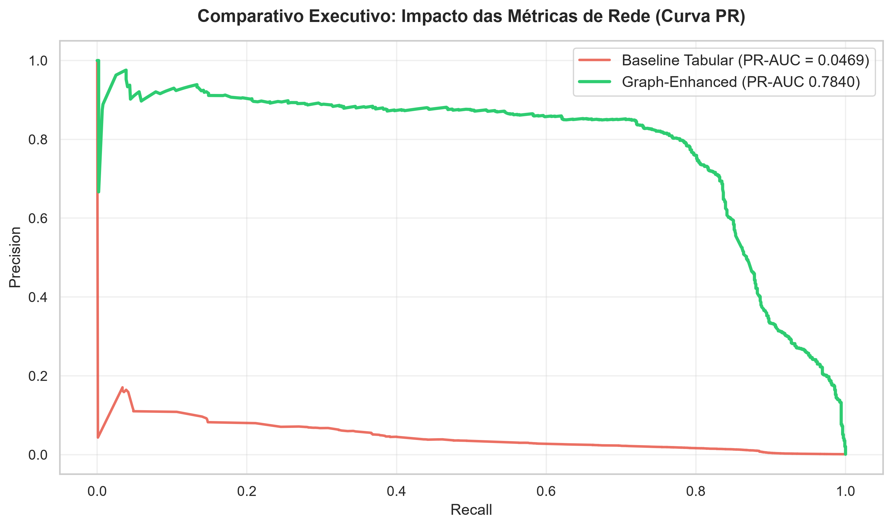
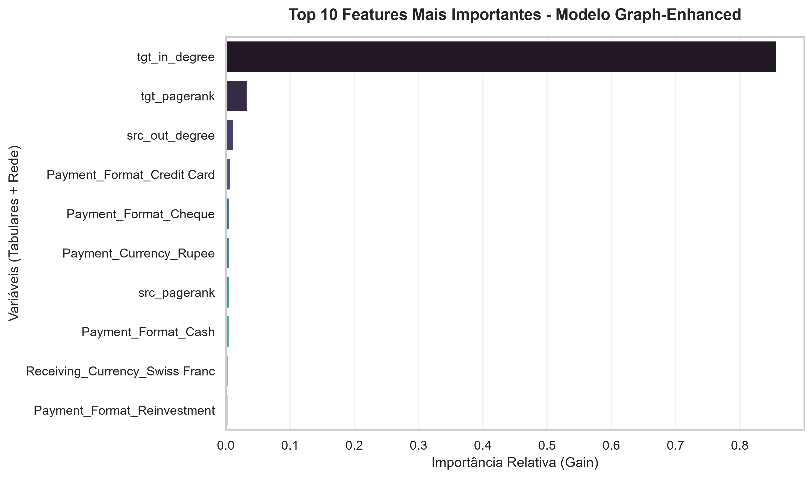

# Visão Geral do Projeto

Os sistemas tradicionais de Prevenção à Lavagem de Dinheiro (*Anti-Money Laundering* - AML) baseados estritamente em regras tabulares sofrem de uma falha crônica: a cegueira estrutural. Eles analisam transações de forma isolada, gerando um volume insustentável de falsos positivos (alarmes falsos).

Este projeto demonstra como injetar **inteligência topológica** (estruturas de rede) em modelos preditivos transforma um classificador inoperante em uma ferramenta de alta precisão para a triagem de compliance em instituições financeiras, usando o dataset (Arquivos HI-Small) do simulador IBM, disponível em [Kaggle](https://www.kaggle.com/datasets/ealtman2019/ibm-transactions-for-anti-money-laundering-aml).

---

## Stack Tecnológica & Arquitetura

O projeto foi construído adotando uma arquitetura híbrida focada em eficiência de memória e persistência relacional:

* **Banco de Dados & Persistência:** `SQLite` (Fonte de verdade e motor de consultas para grandes volumes).
* **Engenharia de Grafos:** `NetworkX` (Construção de grafos direcionados e extração de métricas topológicas em escala).
* **Manipulação & Processamento:** `Python`, `Pandas`, `NumPy`.
* **Modelagem Preditiva:** `XGBoost` (Otimizado para desbalanceamento extremo com `scale_pos_weight`).
* **Avaliação & Visualização:** `Scikit-Learn` (Métrica PR-AUC), `Matplotlib`, `Seaborn`.

---

## Pipeline Metodológico

1. **Auditoria e EDA Tabular (`02_eda_tabular.ipynb`):** Análise exploratória de mais de 5 milhões de transações, identificando padrões de desbalanceamento severo (apenas **0.1%** de fraudes na base) e mapeando o comportamento de moedas e canais de pagamento.
2. **Engenharia Topológica de Redes (`03_engenharia_grafos.ipynb`):**
   * Construção de um grafo direcionado de mais de 57 mil nós.
   * Extração de métricas comportamentais cruciais: *PageRank* (influência sistêmica), *Betweenness Centrality* (pontes e contas-laranja) e *In/Out-Degrees* (identificação de coletores de *smurfing* e dispersores de capital).
   * Persistência estruturada das features de rede diretamente no banco SQLite.
3. **Modelagem Preditiva & Benchmark (`04_modelagem_preditiva.ipynb`):**
   * **Modelo Baseline:** Treinado apenas com dados tabulares tradicionais.
   * **Modelo Graph-Enhanced:** Enriquecido com as métricas topológicas de origem e destino, comparando a performance via curva *Precision-Recall* (PR-AUC).

---

## Resultados e Impacto de Negócio

Para cenários de desbalanceamento extremo (fraudes raras), métricas convencionais como ROC-AUC geram falsas ilusões. O projeto utilizou o **PR-AUC** (*Precision-Recall Area Under Curve*), a métrica rigorosa de mercado para detecção de fraudes.

| Abordagem | PR-AUC Score | Precisão (Classe 1) | Recall | Impacto Operacional |
| :--- | :---: | :---: | :---: | :--- |
| **Baseline Tabular** | `0.0469` | `1.0%` | `0.88` | Inviável (99 alarmes falsos para cada 1 fraude real). |
| **Graph-Enhanced (Com Grafos)** | **`0.7840`** | **`16.0%`** | **`0.99`** | **Salto de +1.571% no PR-AUC**, suprimindo falsos positivos e capturando 99% das fraudes. |



### X-Ray do Modelo (Feature Importance)

A análise de importância de variáveis do XGBoost revelou que o ganho preditivo não veio do acaso:

* **`tgt_in_degree`** isoladamente responde por **86,36%** da árvore de decisão do modelo.
* Isso prova empiricamente que o algoritmo aprendeu a lógica estrutural do crime: **contas que acumulam múltiplas entradas de origem (*smurfing*) representam o principal vetor de risco de lavagem de dinheiro.**



---

## Estrutura do Repositório

```txt
├── data/                      # Bancos de dados SQLite e datasets brutos/processados
├── notebooks/                 # Notebooks Jupyter estruturados por fases
│   ├── 02_eda_tabular.ipynb
│   ├── 03_engenharia_grafos.ipynb
│   └── 04_modelagem_preditiva.ipynb
├── src/                       # Script modular (ingestão de dados e rotinas)
│   └── 01_ingestao_dados.py
├── models/                    # Artefatos e modelos preditivos treinados salvos 
│   └── xgboost_graph_enhanced_aml.pkl
├── output/                    # Gráficos de alta resolução e relatórios visuais
├── requirements.txt           # Dependências do projeto
└── README.md
```

## Como Executar o Projeto

Clone o repositório para o seu ambiente local:

```bash
git clone https://github.com/m-mnzs/projeto-graph-aml
cd projeto-graph-aml
```

Crie e Ative um ambiente virtual:

```bash
python -m venv .venv
source .venv/bin/activate  # No Windows: .venv\Scripts\activate
```

Instale as dependências utilizando o arquivo de configuração:

```bash
pip install -r requiriments.txt
```

Execute o script da pasta src/ e os notebooks da pasta notebooks/ seguindo a numeração sequencial para reproduzir a ingestão, a EDA e a modelagem preditiva.
