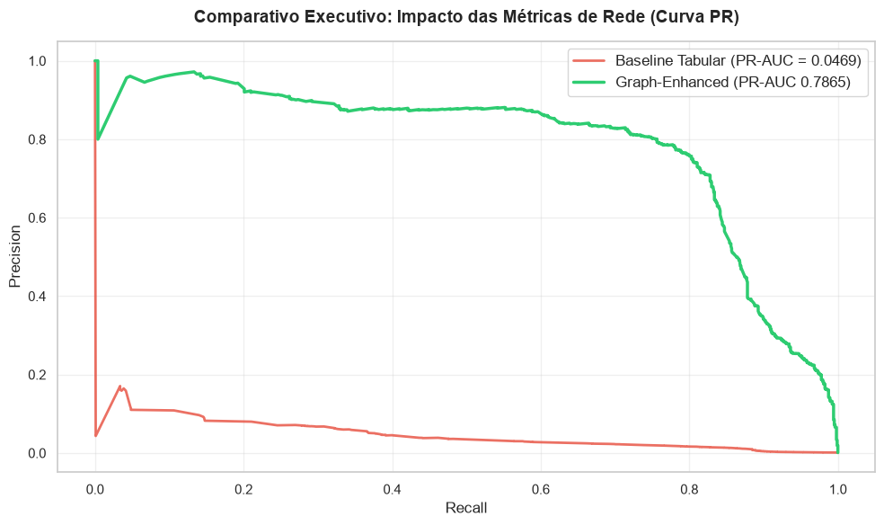

# Detecção Avançada de Lavagem de Dinheiro via Graph-Enhanced Machine Learning

> Um pipeline analítico de ponta a ponta para identificar redes ilícitas e transações suspeitas combinando **Teoria de Grafos (NetworkX)** e **Machine Learning (XGBoost)**.

---

## Visão Geral do Projeto

No ecossistema financeiro tradicional, modelos de detecção de fraudes baseados estritamente em dados tabulares (*amount*, *payment format*, *currency*) sofrem de um grave problema de **cegueira estrutural**. Criminosos estruturam transações fracionadas (*smurfing*) e utilizam contas de passagem (*mule accounts*) para ocultar o rastro do dinheiro, comportamentos que são invisíveis a uma análise de linha isolada.

Este projeto demonstra como a incorporação de **Métricas Topológicas de Rede** (*Graph-Enhanced ML*) resolve essa "miopia" analítica, elevando a precisão preditiva na detecção de lavagem de dinheiro no dataset da IBM.

---

## Arquitetura do Pipeline & Metodologia

O projeto foi modularizado em quatro etapas sequenciais, utilizando **SQLite** como a *Single Source of Truth* para garantir a reprodutibilidade e integridade do pipeline:

1. **`01_coleta_e_carga.ipynb`**: Ingestão e estruturação dos dados brutos no banco relacional SQLite.
2. **`02_eda_e_auditoria.ipynb`**: Análise Exploratória de Dados (EDA) focada em expor as limitações dos modelos tabulares tradicionais frente ao comportamento de redes criminosas.
3. **`03_grafo_e_centralidade.ipynb`**: Construção da sub-rede de risco direcionada utilizando `NetworkX` e extração de propriedades topológicas vitais:
   - **In-Degree / Out-Degree:** Identificação de contas coletoras e dispersoras de capital.
   - **PageRank:** Mapeamento de nós de alta relevância sistêmica.
   - **Betweenness Centrality:** Isolamento de contas-ponte (*mule accounts*).
   *Persistência:* Todas as métricas foram gravadas de volta no banco SQLite para consumo na modelagem.
4. **`04_modelagem_preditiva.ipynb`**: Comparação entre um modelo **Baseline Tabular** e o modelo **Graph-Enhanced (Tabular + Grafos)** utilizando `XGBoost`.

---

## Resultados e Impacto Preditivo

Para lidar com o desbalanceamento severo da base (fraudes representam ~0.1% das transações), utilizamos a métrica **PR-AUC (Precision-Recall Area Under Curve)**, ideal para cenários de fraude, em conjunto com o ajuste de `scale_pos_weight`.

| Abordagem | PR-AUC Score | Precision (Classe Fraude) | Recall (Classe Fraude) | Diagnóstico |
| :--- | :---: | :---: | :---: | :--- |
| **Baseline (Apenas Tabular)** | `0.0469` | `0.01` (1%) | `0.88` | **Cegueira Estrutural** (Dispara falsos positivos em massa) |
| **Graph-Enhanced (Tabular + Rede)** | **`0.7865`** | **`0.16` (16%)** | **`0.99`** | **Salto Massivo (+1.576% de Lift)** e supressão de falsos alarmes |

### Evidência Visual: Curva Precision-Recall

A inclusão das métricas de rede desloca a curva de performance drasticamente para o quadrante superior direito, comprovando a eficácia analítica da abordagem:



### X-Ray do Modelo (Feature Importance)

A análise de importância de ganho (*gain*) do XGBoost revelou que as métricas estruturais de rede dominaram o processo de decisão do algoritmo, com destaque para o grau de entrada de destino (`tgt_in_degree`) e o `tgt_pagerank`, provando que o modelo aprendeu a caçar o crime através da topologia da rede financeira.

---

## Estrutura do Repositório

```text
├── data/                    # Banco SQLite (aml_network.db) e datasets
├── notebooks/               # Notebooks analíticos estruturados por fases
│   ├── 01_coleta_e_carga.ipynb
│   ├── 02_eda_e_auditoria.ipynb
│   ├── 03_grafo_e_centralidade.ipynb
│   └── 04_modelagem_preditiva.ipynb
├── outputs/                 # Gráficos e curvas geradas nas análises
└── README.md                # Documentação executiva do projeto
```

---

## Como Executar o Projeto
Clone o Repositório
```bash
git clone https://github.com/m-mnzs/projeto-graph-aml.git
```
Instale as dependências necessárias
```
pip install pandas numpy scikit-learn xgboost networkx matplotlib seaborn
```
Abra e execute os notebooks na ordem numérica (01 a 04) para reproduzir toda a investigação e modelagem.

## Dados do Projeto
Os dados originais utilizados neste projeto são provenientes do dataset público de transações para Anti-Money Laundering (AML) da IBM disponível no Kaggle. 

Para reproduzir o pipeline localmente:
1. Acesse o Kaggle e baixe os arquivos da base de dados (ex: `HI-Small_Trans.csv`, `HI-Small_accounts.csv`, `HI-Small_Patterns.txt`).
2. Posicione os arquivos brutos dentro da pasta `data/` do projeto.